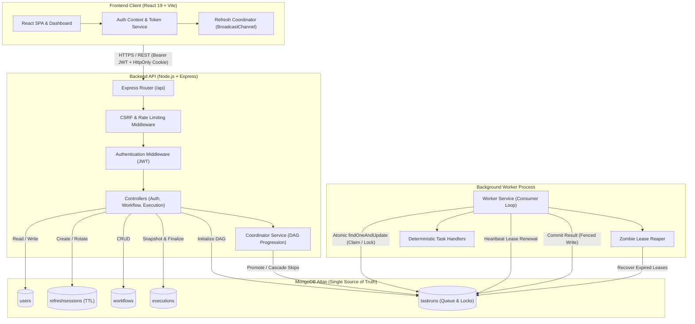

# Replab

<p align="center">
  
</p>

<p align="center">
  <strong>Replab</strong> is a developer-focused workflow orchestration and Directed Acyclic Graph (DAG) execution platform built with Node.js, Express, React, and MongoDB Atlas. It features an asynchronous background worker, atomic task claiming, exponential backoff retries, stale-worker fencing, and owner-scoped authentication with rotating refresh sessions — designed and built from scratch without Redis, BullMQ, or Celery.
</p>

---

## 📋 Table of Contents

- [Problem Statement & Goals](#-problem-statement--goals)
- [Key Features](#-key-features)
- [System Architecture](#-system-architecture)
- [Workflow & DAG Execution Lifecycle](#-workflow--dag-execution-lifecycle)
- [Worker Reliability & Distributed Primitives](#-worker-reliability--distributed-primitives)
- [Authentication & Session Security](#-authentication--session-security)
- [Built-in Task Handlers](#-built-in-task-handlers)
- [REST API Reference](#-rest-api-reference)
- [Tech Stack](#-tech-stack)
- [Repository Layout](#-repository-layout)
- [Prerequisites & Getting Started](#-prerequisites--getting-started)
- [Testing & Test Database Safety](#-testing--test-database-safety)
- [Environment Variable Reference](#-environment-variable-reference)
- [Known Limitations & Architecture Notes](#-known-limitations--architecture-notes)
- [Portfolio Reviewer Walkthrough](#-portfolio-reviewer-walkthrough)
- [Future Roadmap](#-future-roadmap)

---

## 🎯 Problem Statement & Goals

Modern distributed workflow orchestration systems (such as Temporal, Celery, or BullMQ) typically rely on dedicated message brokers or in-memory data stores (e.g., Redis, RabbitMQ, SQS) to manage job queues, task state machines, and concurrency locks. While suitable for high-throughput production workloads, introducing an external queue broker increases operational complexity, requires multi-service synchronization, and obscures the distributed coordination fundamentals happening underneath.

### Project Goals

1. **Demonstrate Distributed Coordination Fundamentals**: Build a robust task queue, atomic locking mechanism, heartbeat lease renewal, and zombie task recovery directly on top of MongoDB Atlas document-level atomic mutations (`findOneAndUpdate`).
2. **Deterministic DAG Execution**: Implement cycle detection (Depth-First Search) and topological dependency scheduling to guarantee that dependent tasks execute only when prerequisites succeed, while isolating failures with transitive skip cascades.
3. **Resilient Background Processing**: Decouple API request handling from long-running task execution using a standalone background worker with configurable concurrency, graceful shutdown, and cooperative timeout cancellation via `AbortController`.
4. **Hardened Multi-Tenant Security**: Implement industry-standard authentication featuring bcrypt-hashed passwords, short-lived JWT access tokens, opaque rotating refresh tokens in HttpOnly cookies, session-family reuse detection, CSRF fail-closed origin validation, and owner-scoped data isolation.
5. **Interactive Observability**: Provide a React SPA featuring topological DAG visualization, non-overlapping execution polling, real-time retry countdowns, and expandable debug inspectors for task inputs and outputs.

---

## ✨ Key Features

- **Topological DAG Workflow Engine**: Validate task graphs for cycles and disconnected dependencies; compute parallel topological execution stages.
- **Queue-Free Worker Architecture**: Standalone Node.js worker process consuming directly from MongoDB Atlas using atomic conditional claims.
- **Worker Leases & Heartbeats**: Leased execution locks prevent competing workers from double-claiming tasks; background heartbeats periodically extend leases for active jobs.
- **Zombie Lease Recovery (Reaper)**: An autonomous reaper process scans for expired worker leases, reclaiming abandoned tasks after ungraceful worker crashes.
- **Stale-Worker Fencing**: Workers verify their unique lock ownership before committing terminal states, safely discarding writes from partitioned or delayed workers.
- **Exponential Backoff Retries**: Configurable retry budgets (`maxRetries`) with exponential backoff delay calculation, delay ceilings, and transient vs. permanent error classification.
- **Worker Timeout & Cancellation**: Cooperative task cancellation using per-attempt `AbortController` instances to cancel async handlers on timeout while preserving the authoritative timeout error.
- **Downstream Skip Cascades**: When a prerequisite fails or exhausts its retry budget, all downstream tasks are automatically marked `skipped` with clear diagnostic reasons.
- **Hashed Refresh Token Sessions**: Opaque refresh tokens stored as cryptographic SHA-256 hashes in MongoDB with automatic TTL index cleanup.
- **Token Rotation & Reuse Detection**: Refresh tokens rotate on every use. Replaying an invalidated token triggers automatic revocation of the entire session family.
- **CSRF-Protected Auth Endpoints**: State-changing refresh and logout endpoints enforce fail-closed `Origin` and `Referer` validation against allowlisted origins.
- **Owner-Scoped Multi-Tenancy**: Workflows and execution runs are strictly isolated to their creator. Attempts to access another user's workflow or execution return HTTP 404 Not Found where the owner-scoped lookup finds no matching resource, helping avoid revealing whether another user's resource exists.
- **In-Memory Frontend Access Tokens**: Access tokens are kept in memory and never persisted in `localStorage`, mitigating token theft via Cross-Site Scripting (XSS).

---

## 🏗️ System Architecture

Replab is architected into four decoupled tiers:

1. **Frontend Client**: React 19 single-page application built with Vite and Tailwind CSS. Manages in-memory JWT tokens, silent cookie refresh, cross-tab session synchronization (`BroadcastChannel`), and live execution monitoring.
2. **Backend API Server**: Node.js and Express REST API. Handles authentication, workflow CRUD, DAG validation, execution scheduling, and rate limiting.
3. **MongoDB Atlas Database**: Primary single source of truth storing users, refresh sessions, workflow templates, execution snapshots, and queued task runs with compound indexes.
4. **Background Worker Process**: Standalone Node.js process decoupled from the Express server. Concurrently polls queued tasks, manages heartbeat leases, runs deterministic task handlers, handles retries, and coordinates downstream dependencies.



---

## 🔄 Workflow & DAG Execution Lifecycle

### 1. Workflow Template Definition
A workflow defines a reusable DAG template containing one or more task definitions. Each task specifies:
- `taskId`: Unique alphanumeric identifier (e.g., `task_1`).
- `taskName`: Descriptive name.
- `taskType`: Built-in handler type (`validate_csv`, `transform_data`, `generate_report`, `send_notification`).
- `dependsOn`: Array of upstream `taskId` strings that must succeed before this task can start.
- `config`: Task-specific input payload.
- `maxRetries`: Maximum retry attempts on failure (default: `2`).

### 2. DAG Validation
Before a workflow or task is saved, `server/src/utils/graphValidator.js` executes:
- **Cycle Detection**: Traverses dependencies using Depth-First Search (DFS) with recursion tracking to guarantee the graph is acyclic.
- **Reference Integrity**: Rejects self-dependencies, duplicate dependencies, and references to nonexistent tasks.
- **Topological Sorting**: Calculates parallel execution stages to visualize the graph structure on the frontend.

### 3. Execution Instantiation
When a user triggers an execution (`POST /api/workflows/:id/execute`):
1. **Immutable Snapshotting**: The API snapshots the workflow's task graph into a parent `Execution` document and creates individual `TaskRun` documents in MongoDB. Later edits to the workflow template never corrupt running or historical executions.
2. **Initial State Assignment**:
   - Tasks with zero dependencies (`dependsOn: []`) are initialized in `status: 'queued'` with `runAfter: now`.
   - Dependent tasks are initialized in `status: 'pending'`.
3. **Execution Record**: The parent `Execution` starts in `status: 'queued'` and transitions to `running`.

### 4. Dependency Coordination (`CoordinatorService`)
As tasks finish, `server/src/services/coordinator.service.js` coordinates state transitions:
- **Prerequisite Promotion**: When all tasks listed in a pending task's `dependsOn` array reach `status: 'succeeded'`, the coordinator atomically promotes the pending task to `status: 'queued'`, making it eligible for worker claiming.
- **Transitive Skip Cascades**: If any prerequisite task fails permanently (or is itself skipped), all downstream tasks depending on it directly or indirectly transition to `status: 'skipped'` with the reason recorded.
- **Execution Finalization**: When all tasks for an execution reach a terminal state (`succeeded`, `failed`, or `skipped`), the parent `Execution` document is updated to `status: 'succeeded'` (if every task succeeded) or `status: 'failed'` (if any task failed or was skipped).

---

## 🛡️ Worker Reliability & Distributed Primitives

Replab implements distributed worker patterns directly in Node.js and MongoDB without external queue dependencies:

### 1. Atomic Task Claiming
Workers run an asynchronous polling loop governed by configurable concurrency (`WORKER_CONCURRENCY`). To claim a task, the worker performs a conditional atomic write:

```javascript
const task = await TaskRun.findOneAndUpdate(
  {
    status: 'queued',
    runAfter: { $lte: new Date() },
  },
  {
    $set: {
      status: 'running',
      lockedBy: this.workerId,
      leaseExpiresAt: new Date(Date.now() + this.leaseDurationMs),
      startedAt: new Date(),
    },
    $inc: { attemptCount: 1 },
  },
  { sort: { runAfter: 1, createdAt: 1 }, new: true }
);
```

Because MongoDB executes single-document updates atomically, competing worker processes can poll concurrently without double-claiming tasks.

### 2. Leases & Heartbeats
When a task is claimed, `leaseExpiresAt` is set to `now + WORKER_LEASE_DURATION_MS` (default: 30 seconds). While the task handler executes, the worker runs a periodic renewal timer:

$$\text{Heartbeat Interval} = \max\left(1000\text{ ms},\, \left\lfloor \frac{\text{leaseDurationMs}}{3} \right\rfloor\right)$$

The heartbeat updates `leaseExpiresAt` in MongoDB as long as `lockedBy === this.workerId`. If the worker process crashes or loses network connectivity, the heartbeat stops and the lease naturally expires.

### 3. Zombie Lease Reaper (`ReaperService`)
A background reaper loop periodically scans for abandoned tasks:

```javascript
// Scan for expired leases
const expiredTasks = await TaskRun.find({
  status: 'running',
  leaseExpiresAt: { $lt: new Date() },
});
```

For each zombie task:
- If `attemptCount <= maxRetries`: Atomically reschedules the task to `status: 'queued'` with exponential backoff and clears lock tokens.
- If retries are exhausted: Atomically marks the task as `status: 'failed'` with an error message indicating lease expiration, triggering downstream skip cascades.

### 4. Stale-Worker Fencing
If a worker experiences an ungraceful event (such as a prolonged GC pause or network stall), the reaper might expire its lease and reassign the task. To prevent split-brain writes, all terminal mutations require lock ownership verification:

```javascript
const result = await TaskRun.updateOne(
  {
    _id: taskRunId,
    status: 'running',
    lockedBy: this.workerId, // Fencing token check
  },
  {
    $set: { status: 'succeeded', output, completedAt: new Date() },
    $unset: { lockedBy: '', leaseExpiresAt: '' },
  }
);

if (result.matchedCount === 0) {
  // Lock was lost or stolen by reaper; discard result cleanly
  logger.warn(`Worker ${this.workerId} lost ownership of task ${taskRunId}; discarding result.`);
}
```

### 5. Retries with Exponential Backoff
When a handler throws a retryable error, the worker evaluates `attemptCount` against `maxRetries`. If eligible, it calculates a delayed execution time:

$$\text{delayMs} = \min\left(\text{retryMaxDelayMs},\, \text{retryBaseDelayMs} \times 2^{(\text{attemptCount} - 1)}\right)$$

The task transitions back to `status: 'queued'` with `runAfter = now + delayMs`, `lockedBy: null`, and `leaseExpiresAt: null`. Non-retryable errors (such as schema validation errors or tasks flagged with `nonRetryable: true`) bypass the retry loop and fail immediately.

### 6. Cooperative Timeout Cancellation
The worker enforces a strict per-task timeout (`WORKER_TASK_TIMEOUT_MS`). Each execution attempt initializes an independent `AbortController`:
- The controller's `AbortSignal` is passed into the task handler context.
- Async operations (such as delayed steps or external requests) listen to the `abort` event and terminate cleanly.
- If the timeout timer fires before completion, `abort()` is triggered and the original timeout `Error` is preserved as the authoritative failure reason for diagnostics, logging, and retry evaluation.

---

## 🔐 Authentication & Session Security

Replab provides a complete, hardened authentication and authorization system:

```
[ Client Browser ]
       │
       ├─ (1) POST /api/auth/login ─────────────► [ Express API ]
       │                                                 │
       │                                                 ├─ Verify credentials (bcrypt)
       │                                                 ├─ Sign JWT access token (15m)
       │                                                 └─ Generate opaque refresh token
       │                                                          │ (Store SHA-256 hash)
       │                                                          ▼
       │◄── (2) 200 OK + { token, user } ─────────── [ MongoDB Atlas (refreshsessions) ]
       │    Cookie: replicalab_refresh_token (HttpOnly)
       │
       ├─ (3) GET /api/workflows (Bearer JWT) ───► [ Verify JWT & Filter by userId ]
       │
       └─ (4) POST /api/auth/refresh (Cookie) ───► [ Validate CSRF -> Rotate Session ]
```

### 1. Password Hashing
User passwords are automatically hashed with `bcryptjs` using 10 salt rounds before storage in MongoDB. Plaintext passwords are never logged, returned, or persisted.

### 2. Dual-Token Architecture
- **JWT Access Tokens**: Short-lived (15 minutes by default), signed with HS256 using `JWT_SECRET` (`issuer: 'replicalab-api'`, `audience: 'replicalab-client'`). The access token identifies the user through its subject claim (`sub`) and includes the user's role. The payload uses `{ sub, role }`. Verified statelessly by the `requireAuth` middleware.
- **Opaque Refresh Tokens**: The refresh token is generated using 32 cryptographically random bytes (256 bits of entropy), encoded as a 64-character hexadecimal string. Only its SHA-256 hash is stored in the database.

### 3. Session Rotation & Reuse Detection
- **Token Rotation**: Every call to `POST /api/auth/refresh` revokes the incoming refresh token and issues a new one within the same `familyId`.
- **Reuse Detection**: If an already-revoked refresh token is presented, the system detects a token replay attack and immediately revokes all active sessions belonging to that `familyId`, terminating the session family across all devices.

### 4. HttpOnly Cookies & CSRF Protection
Refresh tokens are stored in an HttpOnly cookie (`replicalab_refresh_token`), protecting them against JavaScript XSS theft:
- `HttpOnly: true`: Inaccessible to browser scripts.
- `SameSite: 'lax'` (or `'strict'` in production).
- `Secure: true`: Enforced automatically in production environments.
- **CSRF Origin/Referer Fencing**: State-changing authentication requests (`/api/auth/refresh` and `/api/auth/logout`) pass through `validateCsrfProtection`. The middleware enforces a strict **fail-closed** policy: requests must supply an `Origin` or `Referer` header matching the allowlisted `CLIENT_URL`. Requests with absent, malformed, or untrusted origin headers are rejected with HTTP 403 Forbidden.

### 5. In-Memory Frontend Token Storage
The React frontend stores the short-lived JWT access token exclusively in JavaScript memory (`client/src/services/authToken.js`). It is never stored in `localStorage` or `sessionStorage`. On initial application load or tab focus, the client performs a silent refresh using the HttpOnly cookie. Cross-tab refresh synchronization is coordinated via `BroadcastChannel` and local storage locks to prevent redundant rotation races.

### 6. Owner-Scoped Resource Isolation
All `Workflow` and `Execution` documents store a `userId` reference. API endpoints enforce tenant isolation:
- `GET /api/workflows`: Returns only workflows where `userId === req.user._id`.
- `GET /api/workflows/:id`, `PATCH`, `DELETE`: Queries are scoped to the authenticated owner. Attempts to access another user's workflow or execution return HTTP 404 Not Found where the owner-scoped lookup finds no matching resource, which also helps avoid revealing whether another user's resource exists.
- `POST /api/workflows/:id/execute`: Creates executions bound to the authenticated user's ID.

---

## 🧩 Built-in Task Handlers

Task handlers in `server/src/services/taskHandlers.js` are deterministic, safe, and do not execute arbitrary shell commands:

| Task Type | Configuration Options | Handler Execution Logic | Bounded Output Structure |
| :--- | :--- | :--- | :--- |
| **`validate_csv`** | `requiredColumns`, `sampleRows`, `shouldFail` | Validates table headers, non-empty fields, and email formats. | `{ totalRows, validCount, invalidCount, errors: [...10 max], validSample: [...5 max] }` |
| **`transform_data`** | `operations` (`trim_strings`, `uppercase_fields`, `lowercase_fields`, `add_timestamp`), `targetFields`, `records` | Applies safe, predefined string and metadata transformations without `eval`. | `{ recordsProcessed, transformationsApplied, sampleRecords: [...5 max] }` |
| **`generate_report`** | `title`, `shouldFail` | Synthesizes upstream task outputs into a structured JSON report document. | `{ reportId, title, generatedAt, metrics, summary, highlights }` |
| **`send_notification`** | `channel` (`webhook`, `email`, `slack`), `recipient`, `message` | Simulates notification delivery without unmonitored external socket calls. | `{ simulated: true, channel, recipient, status: 'delivered', deliveredAt }` |

---

## 🔌 REST API Reference

All protected routes require an `Authorization: Bearer <token>` header unless authenticated via HttpOnly cookies.

### Authentication Endpoints (`/api/auth`)
- `POST /api/auth/register` — Register a new account. Returns `{ token, user }` and sets refresh cookie.
- `POST /api/auth/login` — Authenticate credentials. Returns `{ token, user }` and sets refresh cookie.
- `POST /api/auth/refresh` — Rotate refresh session via HttpOnly cookie. Returns new `{ token }` (CSRF-protected).
- `POST /api/auth/logout` — Revoke active session family and clear cookie (CSRF-protected).
- `GET /api/auth/me` — Retrieve profile of the authenticated user.

### Workflow Endpoints (`/api/workflows`)
- `GET /api/workflows` — List workflows owned by the authenticated user.
- `GET /api/workflows/:id` — Retrieve a single workflow by ID.
- `POST /api/workflows` — Create a workflow (`{ name, description }`).
- `PATCH /api/workflows/:id` — Update workflow name or description.
- `DELETE /api/workflows/:id` — Delete a workflow and its task definitions.

### Task Management Endpoints (`/api/workflows/:workflowId/tasks`)
- `GET /api/workflows/:workflowId/tasks` — List tasks for a workflow.
- `POST /api/workflows/:workflowId/tasks` — Add a task with validated dependencies.
- `PATCH /api/workflows/:workflowId/tasks/:taskId` — Update task configuration or dependencies (DAG-validated).
- `DELETE /api/workflows/:workflowId/tasks/:taskId` — Delete task and cleanly update downstream dependency lists.

### Execution Endpoints (`/api/executions` & `/api/workflows/:id/executions`)
- `POST /api/workflows/:workflowId/execute` — Trigger an execution run. Returns HTTP 201 Created with initial execution details.
- `GET /api/executions/:executionId` — Retrieve execution status, progress metrics, and sanitized task run outputs.
- `GET /api/workflows/:workflowId/executions` — List execution history for a workflow (supports pagination `?page=1&limit=20`).

### Health Endpoint (`/api/health`)
- `GET /api/health` — Public health check returning API status, uptime, and MongoDB connectivity.

---

## 🛠️ Tech Stack

| Layer | Technology | Version | Purpose |
| :--- | :--- | :--- | :--- |
| **Frontend Framework** | React | `^19.3.1` | Client-side Single Page Application |
| **Build Tooling** | Vite | `^8.3.4` | Development server and production bundling |
| **Styling** | Tailwind CSS | `^4.3.3` | Utility-first responsive interface styling |
| **Backend Runtime** | Node.js | `>= 18.0.0` | Server-side JavaScript runtime (ES Modules) |
| **Web Framework** | Express | `^4.21.2` | RESTful HTTP API routing and middleware |
| **Database** | MongoDB Atlas | Cloud-hosted | Primary document store for state, queues, and auth |
| **Database ODM** | Mongoose | `^8.9.5` | Schema validation, models, and connection handling |
| **Authentication** | JSON Web Tokens | `^9.0.3` | Stateless Bearer token verification (`jsonwebtoken`) |
| **Password Hashing** | bcryptjs | `^3.0.3` | One-way password hashing (10 rounds) |
| **Security Middleware** | Cookie Parser & CORS | `^1.4.7` / `^2.8.5` | HttpOnly cookie parsing and strict origin filtering |
| **Rate Limiting** | express-rate-limit | `^8.7.1` | In-memory burst protection on sensitive routes |

---

## 📁 Repository Layout

```
Replab/
├── client/                             # Frontend React + Vite SPA
│   ├── public/                         # Static assets (favicons, SVGs)
│   ├── src/
│   │   ├── assets/                     # Images and brand graphics
│   │   ├── components/                 # Reusable UI components
│   │   │   ├── ConfirmDeleteModal.jsx      # Workflow deletion dialog
│   │   │   ├── ConfirmDeleteTaskModal.jsx  # Task deletion dialog
│   │   │   ├── ConfirmRunModal.jsx         # Execution confirmation dialog
│   │   │   ├── DependencyGraphView.jsx     # Topological DAG stage visualizer
│   │   │   ├── ExecutionDetailView.jsx     # Live run monitor & task inspector
│   │   │   ├── ExecutionHistoryView.jsx    # Execution history list
│   │   │   ├── Header.jsx                  # Header navigation & user menu
│   │   │   ├── StatusCard.jsx              # System health indicator card
│   │   │   ├── TaskListView.jsx            # Tabular/card list of tasks
│   │   │   ├── TaskModal.jsx               # Task creation/editing modal
│   │   │   ├── WorkflowCard.jsx            # Workflow summary card
│   │   │   ├── WorkflowDetailModal.jsx     # Full workflow & DAG inspector
│   │   │   └── WorkflowModal.jsx           # Workflow creation/editing modal
│   │   ├── context/                    # React Context (AuthContext.jsx)
│   │   ├── hooks/                      # Custom hooks (useHealthCheck, useWorkflows)
│   │   ├── layouts/                    # Layout wrappers (MainLayout.jsx)
│   │   ├── pages/                      # Page views (AuthPage, Dashboard, WorkflowsPage)
│   │   ├── services/                   # Frontend services (api, authToken, refreshCoordinator)
│   │   ├── App.jsx                     # Root React application component
│   │   ├── index.css                   # Tailwind CSS global stylesheet
│   │   └── main.jsx                    # Application bootstrap entry point
│   ├── .env.example                    # Client environment template
│   ├── package.json                    # Client dependencies & scripts
│   └── vite.config.js                  # Vite configuration with Tailwind CSS plugin
│
├── server/                             # Backend Node.js + Express Application
│   ├── scripts/                        # Administrative and migration utilities
│   │   └── migrate-workflow-ownership.js # Safe workflow ownership assignment script
│   ├── src/
│   │   ├── config/                     # Database connection configuration (db.js)
│   │   ├── controllers/                # Request controllers (auth, workflow, execution, health)
│   │   ├── middleware/                 # Middleware (auth, csrf, rateLimiter, errorHandler, notFoundHandler)
│   │   ├── models/                     # Mongoose schemas (user, refreshSession, workflow, execution, taskRun)
│   │   ├── routes/                     # Express routes (auth, workflow, execution, health, index)
│   │   ├── services/                   # Core business logic (worker, coordinator, reaper, execution, taskHandlers)
│   │   └── utils/                      # Utilities (jwt, refreshToken, retryHelper, graphValidator, logger, validators)
│   ├── test-auth.js                    # Auth endpoints test suite
│   ├── test-frontend-integration.js    # Frontend client auth integration suite
│   ├── test-ownership-api.js           # Multi-tenant ownership authorization suite
│   ├── test-ownership-migration.js     # Ownership migration safety suite
│   ├── test-persistent-auth.js         # Persistent auth and session lifecycle suite
│   ├── test-refresh-sessions.js        # Refresh rotation, reuse detection & CSRF suite
│   ├── test-user-model.js              # User schema validation & bcrypt suite
│   ├── test-worker-timeout.js          # Worker timeout & AbortSignal suite
│   ├── test-workflows.js               # Legacy integration test suite (guarded)
│   ├── .env.example                    # Server environment template
│   ├── package.json                    # Server dependencies & scripts
│   ├── server.js                       # Express API server entry point
│   └── worker.js                       # Standalone background worker entry point
│
├── .gitignore                          # Git ignore rules
├── package.json                        # Root orchestration scripts (concurrently)
└── README.md                           # Documentation
```

---

## 🚀 Prerequisites & Getting Started

### Prerequisites
- **Node.js**: Version 18.0.0 or higher (Node.js 20 LTS recommended).
- **npm**: Version 9.0.0 or higher.
- **MongoDB Atlas Cluster**: Free M0 cluster or higher.

### 1. Clone the Repository
```bash
git clone https://github.com/your-username/Replab.git
cd Replab
```

### 2. Install Dependencies
Install all workspace dependencies across root, server, and client:
```bash
npm run install:all
```
*(Alternatively, install individually: `cd server && npm install`, then `cd ../client && npm install`)*

### 3. Configure Server Environment
Create `server/.env` from the provided example:
```bash
cp server/.env.example server/.env
```

Open `server/.env` and configure the following required settings:
- **`MONGODB_URI`**: Paste your MongoDB Atlas connection string.
  - *Example*: `mongodb+srv://<username>:<password>@<cluster>.mongodb.net/replicalab?retryWrites=true&w=majority`
  - *Safety*: Replace `<username>` and `<password>` with your database user credentials. Do not commit this file to version control.
- **`JWT_SECRET`**: Set a cryptographically strong secret string (minimum 32 characters).
  - You can generate one via Node.js in your terminal:
    ```bash
    node -e "console.log(require('crypto').randomBytes(32).toString('hex'))"
    ```
- **`CLIENT_URL`**: Set to the URL of the React frontend (`http://localhost:5173` for local development).
- **`DEFAULT_EXECUTION_ENGINE`**: Set to `worker` to route executions through the background worker.

### 4. Configure Client Environment
Create `client/.env` from the provided example:
```bash
cp client/.env.example client/.env
```
Ensure `VITE_API_BASE_URL` points to your Express API:
```ini
VITE_API_BASE_URL=http://localhost:5000/api
```

### 5. Running the Application

You can start the system using unified scripts or separate dedicated terminals.

#### Option A: Unified Development (API + Client)
From the project root:
```bash
npm run dev
```
Starts both the Express API and the Vite frontend concurrently.

#### Option B: Dedicated Terminals (Recommended for Reviewing the Worker)
To observe background queue processing, lease heartbeats, and logs clearly, run the three processes in separate terminal windows:

**Terminal 1 — Backend API Server:**
```bash
npm run dev:server
```
*API running at `http://localhost:5000` (Health check at `http://localhost:5000/api/health`)*

**Terminal 2 — Standalone Background Worker:**
```bash
npm run dev:worker
```
*Starts the background worker connected to MongoDB Atlas with active lease management and reaper routines.*

**Terminal 3 — Frontend Client:**
```bash
npm run dev:client
```
*Vite development server running at `http://localhost:5173`.*

---

## 🧪 Testing & Test Database Safety

Replab includes a comprehensive test suite divided into focused, isolated test files that test domain modules independently.

### Isolated Test Suites
Each modern test suite targets an isolated test database (e.g., `replicalab_test_auth`, `replicalab_test_worker_timeout`) to prevent any crossover with development or production data:

```bash
# Run User model and bcrypt validation tests
node server/test-user-model.js

# Run Authentication API tests (register, login, me, rate limiting)
node server/test-auth.js

# Run Refresh session rotation, reuse detection & CSRF tests
node server/test-refresh-sessions.js

# Run Persistent auth and cross-tab coordination tests
node server/test-persistent-auth.js

# Run Multi-tenant ownership authorization tests (401/404 checks)
node server/test-ownership-api.js

# Run Worker timeout cancellation and AbortSignal tests
node server/test-worker-timeout.js

# Run Frontend auth client integration tests
node server/test-frontend-integration.js
```

### Dedicated Test Database Convention & Safety Guard

> [!CAUTION]
> **Legacy Test Suite Warning (`server/test-workflows.js`)**:
> The legacy monolithic test suite performs destructive collection resets (`TaskRun.deleteMany({})`) to ensure clean state between test stages. **It must never run against a primary development or production database.**

To guarantee safety, `server/test-workflows.js` is protected by a strict, **fail-closed safety guard**:
1. It inspects `process.env.DB_NAME` at startup.
2. It rejects missing or undefined database configurations.
3. It strictly forbids running against the primary database name (`replicalab`).
4. It requires `DB_NAME` to explicitly start with `replicalab_test_` (e.g., `replicalab_test_workflows`).
5. Running `npm test` or `node server/test-workflows.js` without explicitly providing an allowed test database exits immediately with status code `1` before connecting to MongoDB or executing any queries.

To run the legacy integration suite safely, explicitly provide an isolated test database name:

```bash
# Linux / macOS / Git Bash (POSIX)
DB_NAME=replicalab_test_workflows node server/test-workflows.js
```

```powershell
# Windows (PowerShell)
$env:DB_NAME="replicalab_test_workflows"
node server/test-workflows.js
```

> [!IMPORTANT]
> The first PowerShell command sets the `DB_NAME` environment variable for the current PowerShell session, ensuring the test suite runs against the dedicated test database. The target database must be exclusively dedicated to testing. This suite executes destructive operations (including wiping test collections such as `TaskRun`) and must never target the primary `replicalab` database.

---

## ⚙️ Environment Variable Reference

### Server Configuration (`server/.env`)

| Variable | Type | Description | Default |
| :--- | :--- | :--- | :--- |
| `PORT` | Number | Port number for Express API server | `5000` |
| `NODE_ENV` | String | Environment mode (`development`, `production`, `test`) | `development` |
| `MONGODB_URI` | String | MongoDB Atlas connection string | *Required* |
| `DB_NAME` | String | Target database name | `replicalab` |
| `CLIENT_URL` | String | Allowed frontend origin for CORS and CSRF validation | `http://localhost:5173` |
| `DEFAULT_EXECUTION_ENGINE` | String | Default execution mode (`worker` or `legacy`) | `worker` |
| `WORKER_ID` | String | Unique worker identifier | `worker_<pid>_<random>` |
| `WORKER_CONCURRENCY` | Number | Maximum concurrent tasks processed by worker | `2` |
| `WORKER_POLLING_INTERVAL_MS`| Number | Empty queue polling interval (ms) | `1000` |
| `WORKER_LEASE_DURATION_MS` | Number | Lock lease expiration duration (ms) | `30000` |
| `WORKER_TASK_TIMEOUT_MS` | Number | Per-task execution timeout threshold (ms) | `15000` |
| `WORKER_SHUTDOWN_TIMEOUT_MS`| Number | Graceful shutdown timeout wait time (ms) | `10000` |
| `RETRY_BASE_DELAY_MS` | Number | Initial exponential backoff delay (ms) | `1000` |
| `RETRY_MAX_DELAY_MS` | Number | Maximum exponential backoff delay ceiling (ms) | `30000` |
| `REAPER_INTERVAL_MS` | Number | Background zombie lease scan interval (ms) | `10000` |
| `REAPER_BATCH_SIZE` | Number | Maximum expired leases processed per sweep | `50` |
| `LOG_FORMAT` | String | Server logging format (`text` or `json`) | `text` |
| `LOG_LEVEL` | String | Minimum log level (`debug`, `info`, `warn`, `error`) | `info` |
| `JWT_SECRET` | String | Secret key for signing access tokens (>= 32 chars) | *Required* |
| `JWT_EXPIRES_IN` | String | Access token expiration duration | `15m` |
| `REFRESH_COOKIE_NAME` | String | Name of the HttpOnly refresh token cookie | `replicalab_refresh_token` |
| `REFRESH_TOKEN_EXPIRES_DAYS`| Number | Refresh session lifetime in days | `7` |
| `COOKIE_SAME_SITE` | String | SameSite cookie policy (`lax`, `strict`, `none`) | `lax` |
| `TRUST_PROXY` | Boolean/Number | Express trust proxy configuration for reverse proxies | `false` |

### Client Configuration (`client/.env`)

| Variable | Type | Description | Default |
| :--- | :--- | :--- | :--- |
| `VITE_API_BASE_URL` | String | Base endpoint URL for the backend API | `http://localhost:5000/api` |

---

## ⚠️ Known Limitations & Architecture Notes

1. **At-Least-Once Delivery**: Like all distributed task queues, network partitions or worker crashes during output commits can cause a task to be re-executed by another worker. Handlers performing external mutations must be idempotent.
2. **In-Memory Rate Limiting**: The API rate limiters (`express-rate-limit`) currently use an in-memory store. For multi-instance horizontal scaling, a distributed memory store (such as Redis) would be required to share rate limits across multiple API containers.
3. **Cooperative Timeout Cancellation**: In JavaScript, CPU-bound synchronous code or non-abortable native I/O cannot be pre-emptively halted by an external thread. Handlers must cooperatively check `signal.aborted` or pass the `AbortSignal` into async libraries (e.g., `fetch` or timer helpers) to stop processing promptly.
4. **Refresh Session Cleanup**: Revoked refresh sessions are soft-deleted (`isRevoked: true`) and retained in MongoDB until their natural TTL expiration date (`expiresAt` index), allowing the reuse detection algorithm to identify token replay attempts.
5. **Reverse Proxy Configuration (`TRUST_PROXY`)**: When deploying behind a reverse proxy (e.g., Nginx, AWS ALB, Cloudflare), `TRUST_PROXY` must be explicitly configured to the appropriate hop count. Leaving it `false` causes rate limiters to track the proxy's IP rather than the client IP.

---

## 🎬 Portfolio Reviewer Walkthrough

Follow these steps to explore and test the platform's core capabilities:

### Step 1: User Registration & Session Inspection
1. Navigate to `http://localhost:5173`.
2. Click **Create an account** and register with a name, email, and password.
3. Open your browser's Developer Tools:
   - **Application -> Cookies**: Notice the `replicalab_refresh_token` cookie marked `HttpOnly` and `SameSite=Lax`.
   - **Application -> Local Storage**: Notice that no access tokens or passwords are stored in local storage.
4. Refresh the page: the application performs a silent refresh using the HttpOnly cookie and keeps you seamlessly authenticated.

### Step 2: Create a Multi-Stage Workflow DAG
1. Click **+ New Workflow**.
2. Name the workflow `Data Ingestion & Report Pipeline` and save.
3. Open the workflow and click **Add Task** to build a 4-step pipeline:
   - **Task 1 (`validate_raw_csv`)**: Type `validate_csv`. Dependencies: None (Root).
   - **Task 2 (`clean_and_enrich`)**: Type `transform_data`. Dependencies: `validate_raw_csv`.
   - **Task 3 (`compile_pdf_report`)**: Type `generate_report`. Dependencies: `clean_and_enrich`.
   - **Task 4 (`dispatch_slack_alert`)**: Type `send_notification`. Dependencies: `compile_pdf_report`.
4. Switch to the **DAG Graph View** tab to inspect the visual dependency hierarchy.

### Step 3: Trigger Execution & Live Monitoring
1. Click **Run Workflow**.
2. Select the `worker` execution engine.
3. Observe the live execution monitor:
   - Root task `validate_raw_csv` immediately switches to `running` while downstream tasks show `pending`.
   - Watch the multi-segment progress bar increment dynamically as each stage finishes.
   - Click on any completed task to open the expandable drawer and inspect its bounded JSON output.

### Step 4: Verify Retries, Exponential Backoff & Skip Cascades
1. Edit Task 1 (`validate_raw_csv`) and set `shouldFail: true` in its configuration with `maxRetries: 2`.
2. Trigger a new execution:
   - Observe Task 1 enter `running`, fail, and transition to a countdown state indicating its exponential backoff delay before the next attempt.
   - Check the worker terminal to see retry scheduling logs and delay calculations.
   - When retries are exhausted, observe Task 1 reach `failed` and watch Tasks 2, 3, and 4 automatically transition to `skipped` with clear diagnostic reasons.

### Step 5: Test Multi-Tenant Isolation
1. Log out using the user menu.
2. Register a new user account (e.g., `user2@example.com`).
3. Confirm that the dashboard is completely empty: the workflows and executions created by the first user are strictly inaccessible. Attempting to access the first user's workflow ID directly returns HTTP 404 Not Found where the owner-scoped query finds no matching record, which also prevents revealing whether another user's resource exists.

---

## 🔮 Future Roadmap

Potential enhancements for future iterations of Replab:

- [ ] **WebSocket / SSE Live Streaming**: Replace sequential polling with Server-Sent Events or WebSockets for instant, event-driven task state updates.
- [ ] **Dynamic Workflow Templating**: Support runtime task input interpolation (passing outputs from upstream tasks directly into downstream configs).
- [ ] **Distributed Rate Limiting**: Add a Redis or KeyDB adapter for multi-instance API deployments behind load balancers.
- [ ] **External Worker Agents**: Allow remote worker nodes to connect over gRPC or mutual TLS to process compute-intensive tasks off-cluster.
- [ ] **Workflow Cron Triggers**: Built-in cron scheduler to automatically trigger recurring execution instances.

---

## 📄 License

This project is licensed under the [ISC License](LICENSE).